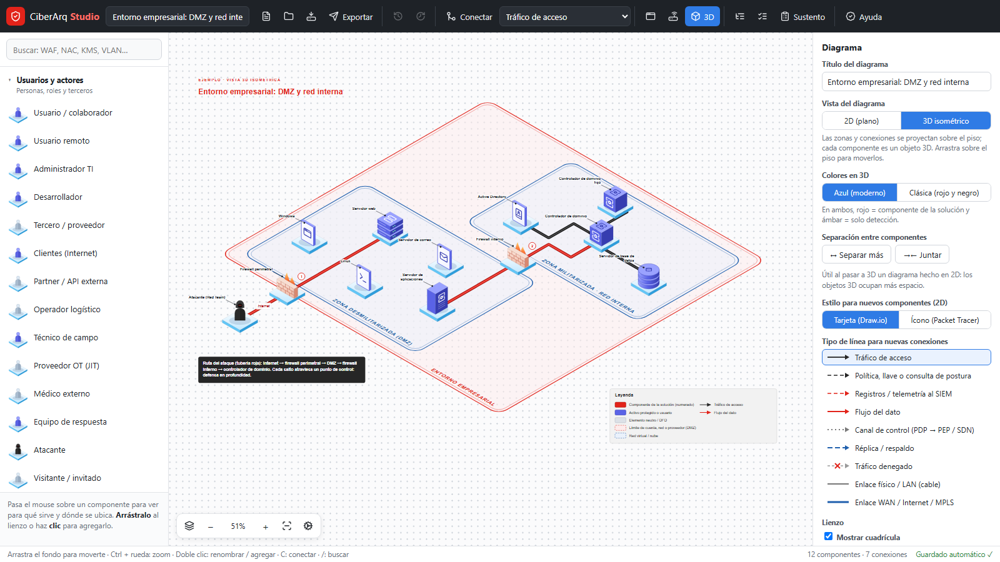
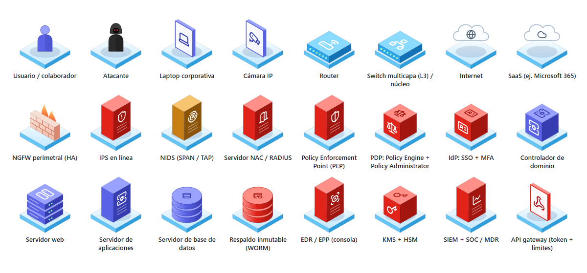
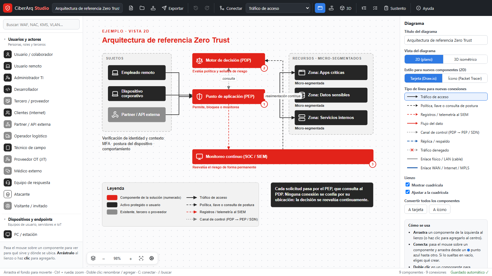

# CiberArq Studio

**Diagramador web de arquitecturas de ciberseguridad, con vista 2D y 3D isométrica.**
*Web-based cybersecurity architecture diagram editor with 2D and isometric 3D views.*

[](https://ciberarq-studio.onrender.com)
[](LICENSE)


**▶ Pruébalo en: https://ciberarq-studio.onrender.com**



## ¿Qué es?

CiberArq Studio es un editor de diagramas pensado para diseñar arquitecturas de seguridad: segmentación con DMZ y VLANs, Zero Trust (PEP/PDP), SASE, IAM, protección de endpoints, nube, datos y aplicaciones. Combina la rapidez de Draw.io con iconografía de red al estilo Packet Tracer, y suma una **vista 3D isométrica** que convierte cualquier diagrama en una maqueta en perspectiva.

Funciona 100 % en el navegador: no hay servidor, base de datos ni instalación.

## Características

- **196 componentes de seguridad** en 16 categorías, cada uno con una explicación de qué es y dónde se ubica en una arquitectura. Incluye firewalls/NGFW, WAF, IDS/IPS, NAC, ZTNA, SSE/CASB, IdP/MFA/PAM, Active Directory, EDR/UEM, KMS/HSM, DLP, SIEM/SOC, respaldo inmutable y más.
- **Vista 3D isométrica**: cada componente se convierte en un objeto en perspectiva sobre una plataforma: servidores apilados, torres, cubos, cilindros, firewalls de ladrillo con llamas, nubes y personas. Las zonas y las conexiones se proyectan sobre el piso como tuberías. Cambiar entre 2D y 3D no altera el diagrama.
- **Zonas y contenedores** (DMZ, VLAN, sede, cuenta cloud, límite de confianza): al moverlos se desplaza su contenido.
- **9 tipos de conexión**: tráfico, política, telemetría al SIEM, flujo de datos, canal de control, réplica, denegado, LAN y WAN. Se trazan solas de forma ortogonal y admiten etiquetas y pasos numerados.
- **Convención de colores**:

  | Color | Significado |
  |---|---|
  | Rojo | Control propuesto (numerado) |
  | Negro | Activo o usuario |
  | Gris | Existente o tercero |
  | Ámbar | Solo detección |

  La **leyenda se genera automáticamente**.
- **Tabla de justificación** de cada control (por qué se incluye y qué requisito atiende). Se puede copiar a Excel/Word o exportar a CSV.
- **Productividad**: deshacer/rehacer, copiar/pegar, alinear y distribuir, búsqueda rápida (`/`), modo conectar (`C`) y autoguardado.
- **Exportación** a PNG en alta resolución, SVG, JSON e impresión/PDF.
- **Diseño adaptable**: se puede usar desde una pantalla angosta.

<p align="center"></p>



## Aspectos técnicos

- **Sin frameworks ni build**: unas 2 500 líneas de JavaScript, CSS y HTML puros, con todo el renderizado en SVG.
- **Motor isométrico propio** (`js/iso.js`):
  - Proyección isométrica de 30° mediante matrices SVG.
  - Objetos 3D generados por código: cajas con tres caras sombreadas, cilindros, flamas con degradados e íconos mapeados sobre caras en perspectiva.
  - Transformación inversa para arrastrar elementos sobre el piso proyectado.
- **Editor**:
  - Ruteo ortogonal de conexiones.
  - Selección por *hit-testing* sobre el DOM real, válido en 2D y 3D.
  - Historial de deshacer basado en *snapshots*.
  - Medición de texto con Canvas para ajustar etiquetas.
  - Exportación PNG rasterizando el SVG en un `<canvas>`.
- **Persistencia local** con `localStorage`: autoguardado y biblioteca de diagramas, más importación/exportación JSON.
- **Despliegue** como sitio estático en Render, con publicación automática en cada `git push`.

## Ejecutar localmente

```bash
git clone https://github.com/Pedrobravo-notfound/ciberarq-studio.git
cd ciberarq-studio
python -m http.server 8080
```

Luego abre http://localhost:8080. También funciona abriendo `index.html` directamente, sin conexión.

## Uso rápido

| Acción | Cómo |
|---|---|
| Agregar | Arrastra desde la izquierda, haz clic en el componente o pulsa `/` para buscar |
| Conectar | Arrastra desde un punto azul hasta otro componente, o usa `C` (modo conectar) |
| Renombrar | Doble clic o `F2` |
| Seleccionar varios | `Shift` + clic o `Shift` + arrastrar |
| Moverse / zoom | Arrastra el fondo · `Ctrl` + rueda · `0` ajusta a la pantalla |
| Vista 3D | Botón **3D** (vuelves con **Tarjeta** o **Ícono**) |

## Estructura

```
index.html          Interfaz
css/app.css         Estilos (claro, adaptable)
js/app.js           Editor: render SVG, interacción, historial, exportación
js/iso.js           Motor de vista 3D isométrica
js/catalog.js       Catálogo de componentes, roles y tipos de conexión
js/icons.js         Subconjunto de íconos Lucide
render.yaml         Configuración de despliegue en Render
```

## Licencia

[MIT](LICENSE). Los íconos provienen de [Lucide](https://lucide.dev) (licencia ISC); ver [THIRD_PARTY_NOTICES.md](THIRD_PARTY_NOTICES.md).
